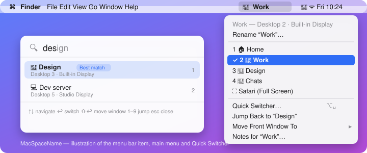

<p align="center">
  
</p>

<h1 align="center">MacSpaceName</h1>

<p align="center">
  <strong>Pomenuj si plochy (Spaces) na Macu. Názov vidíš v menu bare aj v Mission Control a na ľubovoľnú plochu skočíš podľa mena.</strong><br>
  Zadarmo, open source, bez telemetrie. English version: <a href="README.md">README.md</a>
</p>

---

macOS ti dovolí vytvoriť koľko chceš plôch, ale vždy sa budú volať iba *Plocha 1*, *Plocha 2*, *Plocha 3*… MacSpaceName to rieši. Je to malá aplikácia v menu bare, ktorá dá každej ploche **názov, ikonu a farbu**, ukazuje aktuálnu plochu tam, kde ju vidíš, a umožní **prepínať podľa mena** cez prepínač v štýle Spotlightu.

Je to open-source verzia nápadov z komerčnej aplikácie [SpaceJump](https://www.getspacejump.com/) – obsahuje všetky jej funkcie a pár navyše. Nevyžaduje vypnutie SIP ani injektovanie kódu do Docku.

## Funkcie

| | Funkcia | Čo robí |
|---|---|---|
| 🏷️ | **Názvy, ikony, farby** | Každej ploche daj názov (aj s diakritikou), emoji alebo SF Symbol ikonu a farbu. |
| 📍 | **Menu bar** | Ikona a názov aktuálnej plochy sú v menu bare. Štýl: *ikona + názov*, *názov*, *ikona* alebo *číslo + názov*. |
| 🪟 | **Názvy v Mission Control** | Vlastné názvy sa zobrazia priamo nad plochami v Mission Control – ako prekryvné okná, bez zásahu do systému. *(experimentálne)* |
| ⚡ | **Quick Switcher** | `⌥ Space` otvorí plávajúci prepínač. Píš na filtrovanie (fuzzy, ignoruje diakritiku), `↑ ↓` pohyb, `↩` prepnúť, `1–9` skok, `Esc` zavrieť. Najlepšia zhoda je označená. |
| ↩️ | **Skok späť** | Stlač skratku prepínača dvakrát alebo použi samostatnú skratku a vrátiš sa na predchádzajúcu plochu. |
| ⌨️ | **Skratky pre jednotlivé plochy** | Nahraj globálnu skratku pre ktorúkoľvek plochu. Plus skratky ďalšia / predchádzajúca / premenovať / pozastaviť meranie času. |
| 🖱️ | **Drag to Move** | Podrž `⇧ Shift` pri ťahaní okna: zhora sa vysunie lišta plôch; podrž kurzor nad plochou a okno sa tam presunie. |
| 🔔 | **Space Hover** | Nechaj kurzor na výreze kamery (alebo hore v strede displeja bez výrezu) a zobrazia sa všetky plochy; kliknutím prepneš. |
| 📝 | **Poznámky a checklisty** | Každá plocha má vlastné poznámky a zoznam úloh. |
| ▶️ | **Automatizácie „On Click“** | Skupiny akcií – otvoriť aplikácie, priečinky, URL, spustiť Apple Shortcut alebo shell príkaz – z menu baru alebo automaticky pri vstupe na plochu. |
| ⏱️ | **Meranie času** | Automatické meranie podľa plochy a aplikácie s detekciou nečinnosti, pauza/pokračovanie, pomenované session a export do CSV. Všetko lokálne. |
| 🖥️ | **Viac displejov** | Funguje s „Displeje majú samostatné plochy“ zapnutým aj vypnutým; plochy sú zoskupené podľa displeja a číslované zľava doprava ako v Mission Control. |
| 🔗 | **URL schéma** *(navyše)* | `open "macspacename://switch?name=Práca"` zo Shortcuts, Raycastu, Alfredu, skriptov… |
| 📦 | **Export / import** *(navyše)* | Celá konfigurácia je jeden JSON súbor, ktorý si zálohuješ alebo synchronizuješ. |
| 🔁 | **Skratky ďalšia / predchádzajúca plocha** *(navyše)* | Cyklické prepínanie plôch na aktuálnom displeji. |

Názvy prežijú reštart (sú viazané na stabilné UUID plochy). Aplikácia funguje úplne offline a nikam nič neposiela.

## Inštalácia

### Stiahnutie

1. Stiahni `MacSpaceName-<verzia>.dmg` zo stránky [Releases](https://github.com/jakubfabrici/macspacename/releases) (je tam aj `.zip`).
2. Otvor obraz a pretiahni **MacSpaceName** do **Applications**.
3. Aplikácia je podpísaná ad hoc, nie notarizovaná, takže macOS prvé spustenie zablokuje. Buď spusti
   ```sh
   xattr -dr com.apple.quarantine /Applications/MacSpaceName.app
   ```
   alebo ju skús raz otvoriť a potom v *Systémové nastavenia → Súkromie a bezpečnosť* klikni **Aj tak otvoriť** (na macOS 14 a starších funguje aj pravý klik → **Otvoriť**).
4. Spusti ju. Žije iba v menu bare (nemá ikonu v Docku).

### Zostavenie zo zdrojákov

Potrebuješ Xcode 15+ (Swift 5.9) na macOS 13+.

```sh
git clone https://github.com/jakubfabrici/macspacename.git
cd macspacename
make install        # zostaví univerzálnu MacSpaceName.app a skopíruje ju do /Applications
```

Ďalšie ciele: `make bundle` (iba zostaviť do `dist/`), `make run`, `make test`, `make zip`, `make dmg`, `make clean`. Priečinok môžeš otvoriť aj v Xcode (`xed .`) a spustiť schému `MacSpaceName`.

## Prvé spustenie

Prepínanie plôch potrebuje oprávnenie **Prístupnosť (Accessibility)** – MacSpaceName za teba stláča systémové skratky Mission Control. Pri prvom prepnutí sa ťa systém opýta:

*Systémové nastavenia → Súkromie a bezpečnosť → Prístupnosť → povoliť MacSpaceName.*

Zoznam a pomenovanie plôch, zobrazenie v menu bare, poznámky, akcie a meranie času fungujú aj bez neho.

## Používanie

### Premenovanie plochy

* Klikni na položku v menu bare → **Rename “Desktop 2”…**, alebo
* použi skratku **Rename current space** (nahráš ju v Settings → Shortcuts), alebo
* otvor **Settings → Spaces** a uprav názov, ikonu, farbu, skratku a automatizáciu všetkých plôch naraz.

Prázdny názov vráti predvolené *Desktop N*.

### Prepínanie plôch

* Klikni na plochu v menu.
* `⌥ Space` → napíš časť názvu → `↩`. Fungujú aj čísla (`3 ↩`). `⇧ ↩` namiesto prepnutia presunie predné okno.
* Skratky pre plochy, skratky ďalšia/predchádzajúca, skok späť.
* Nechaj kurzor na výreze / hornej hrane a klikni na plochu.
* `open "macspacename://switch?name=Práca"`.

### Presun okna na inú plochu

* Podrž `⇧` pri ťahaní okna a nechaj kurzor nad plochou v lište, ktorá sa objaví, alebo
* menu → **Move Front Window To →** *plocha*, alebo
* Quick Switcher s `⇧ ↩` (alebo skratka pre režim *move window*).

### Automatizácie

**Settings → Actions**: vytvor skupinu, pridaj kroky (otvoriť aplikáciu, súbor/priečinok, URL, spustiť Apple Shortcut, spustiť shell príkaz). Spustíš ju z menu (**Run Actions ▸**) alebo ju nastavíš ako akciu **On enter** pre plochu. Ak chceš pri vstupe na plochu zapnúť režim Sústredenie (Focus), vytvor Apple Shortcut, ktorý ho nastaví, a spusti ho zo skupiny.

### Meranie času

Meranie je predvolene zapnuté a úplne lokálne. Každá zmena plochy alebo prednej aplikácie začne nový záznam; nečinnosť (predvolene 5 minút bez vstupu) sa automaticky odstráni. Z menu otvor **Time Tracking…** – súčty podľa plochy / aplikácie / session za dnes, tento týždeň alebo celé obdobie, pauza, názov session, export CSV, vymazanie. Vypnúť sa dá v **Settings → Time**.

### Klávesové skratky

| Skratka | Akcia | Predvolené |
|---|---|---|
| Open Quick Switcher | plávajúci prepínač; opakované stlačenie s prázdnym poľom = skok späť | `⌥ Space` |
| Open Quick Switcher in *move window* mode | vyber, kam ide predné okno | — |
| Jump back | späť na predchádzajúcu plochu | — |
| Next / Previous Space | cyklus na aktuálnom displeji | — |
| Rename current Space | otvorí dialóg premenovania | — |
| Pause / resume tracking | prepne meranie času | — |
| Plocha „X“ | skok priamo na danú plochu (Settings → Spaces) | — |

V Quick Switcheri: `↑ ↓ / Tab` pohyb · `↩` prepnúť · `⇧ ↩` presunúť okno · `1–9` skok · `⌘ 1–9` skok aj počas písania · `Esc` zavrieť.

## Ako to funguje (v skratke)

* **Čítanie plôch** – privátne volanie window servera `CGSCopyManagedDisplaySpaces` (používajú ho aj WhichSpace a Spaceman) vráti každý displej s jeho plochami, UUID a informáciou, ktorá je aktuálna. Aplikácia ho číta znova pri notifikácii o zmene plochy, zmene displejov, zmene `com.apple.spaces.plist` a každých 5 s pre istotu.
* **Prepínanie** – macOS nemá verejné API, preto aplikácia spúšťa systémové skratky *Prejsť na plochu N* / *Posunúť o plochu doľava/doprava*. Tie sú predvolene vypnuté, takže si prečíta ich klávesovú kombináciu z window servera, na okamih stlačenia ich zapne a hneď zasa vypne. Celoobrazovkové aplikácie sa dosiahnu aktivovaním aplikácie.
* **Názvy v Mission Control** – kým je Mission Control otvorené, Dock (na novších systémoch WindowManager) sprístupňuje lištu plôch cez Accessibility. Aplikácia prečíta pozíciu každej miniatúry a položí nad ňu malé prekryvné okno, ktoré neprijíma kliknutia.
* **Drag to Move** – macOS vezme držané okno so sebou pri zmene plochy; aplikácia iba prepne, kým okno držíš.

Dlhá verzia s vysvetlením každého privátneho volania je v [docs/how-it-works.md](docs/how-it-works.md) (anglicky).

## Stav projektu

Verzia 0.x. Kód sa zostavuje a logika je otestovaná jednotkovými testami na macOS runneroch GitHubu; použité techniky sú overené inými open-source nástrojmi. Funkcie označené *experimentálne* (názvy v Mission Control, Drag to Move, presun okien) závisia od nezdokumentovaného správania, ktoré Apple môže kedykoľvek zmeniť. Ak sa niečo na tvojom Macu správa inak, [založ issue](https://github.com/jakubfabrici/macspacename/issues) s verziou macOS.

## Dokumentácia

* [Funkcie do detailu](docs/features.md)
* [Ako to funguje](docs/how-it-works.md)
* [URL schéma](docs/url-scheme.md)
* [Architektúra a mapa kódu](docs/architecture.md)
* [Riešenie problémov](docs/troubleshooting.md)
* [Prispievanie](CONTRIBUTING.md) · [Changelog](CHANGELOG.md)

## Súkromie

Žiadna analytika, žiadny prístup na sieť, žiadne účty. Konfigurácia je v `~/Library/Application Support/MacSpaceName/config.json`, záznam času v `timelog.json` vedľa nej, skratky v `UserDefaults` aplikácie.

## Poďakovanie

* [SpaceJump](https://www.getspacejump.com/) za sadu funkcií, ktorá tento projekt inšpirovala.
* [WhichSpace](https://github.com/gechr/WhichSpace) a [Spaceman](https://github.com/Jaysce/Spaceman) za postup čítania plôch a spúšťania systémových skratiek.
* [Hammerspoon](https://github.com/Hammerspoon/hammerspoon) za accessibility strom Mission Control.
* [KeyboardShortcuts](https://github.com/sindresorhus/KeyboardShortcuts) od Sindreho Sorhusa za globálne skratky.

## Licencia

[MIT](LICENSE) © Jakub Fabrici
